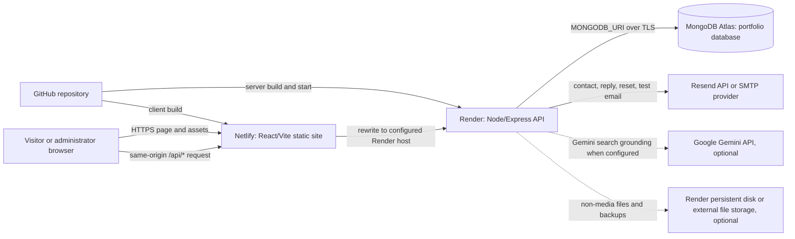

# Production Deployment Guide

This guide covers deploying the project in this folder:

```text
E:\College\portfolio\windows-11-os-portfolio-local
```

It documents the repository as inspected; it does not deploy the site or change
application configuration. Follow the project-specific notes, especially the
existing Netlify API proxy target and the file-storage and PWA limitations.

## 1. Project architecture

| Area | Project location | Role |
| --- | --- | --- |
| React + Vite frontend | `client/` | Windows-style portfolio UI and browser-side API calls |
| Express + TypeScript backend | `server/` | REST API, admin/authentication, contact/email, search, and file handling |
| MongoDB models/configuration | `server/models/`, `server/config/dbConfig.ts` | Persistent portfolio content, admin sessions, contacts, analytics, metadata, and other collections |
| Netlify configuration | `netlify.toml` | Frontend build, `/api/*` proxy, and single-page-app fallback |
| Render deployment configuration | Render dashboard | Backend Web Service; no `render.yaml` was found |

The manifests declare React 19 and Vite 6 for the client and Express 4,
Mongoose 9, Nodemailer, and `@google/genai` for the server. The manifests do
not declare a Node.js `engines` range. The locked `mongodb-memory-server`
dependency declares Node.js `>=20.19.0`; choose a Render-supported Node version
that meets this and all other dependency requirements, and verify it in the
build logs.



### Request flow

1. A browser loads the built static site from Netlify.
2. The client sends requests to relative paths such as `/api/auth/login`,
   `/api/contact`, and `/api/portfolio-content`; no client API-base environment
   variable was found in the frontend source.
3. The first `/api/*` redirect in `netlify.toml` proxies those requests to
   `https://portfolio-ub24.onrender.com/api/:splat`.
4. The Express service receives the request, checks input/authentication as
   applicable, and reads or writes records in MongoDB using Mongoose.
5. Depending on the route, the service may send email, call Gemini, or read/write
   a file. The browser does not connect directly to Atlas or receive server
   credentials.

**Before production:** confirm that
`https://portfolio-ub24.onrender.com` is the intended live Render service. If
the Render service has a different URL, the `/api/*` target in `netlify.toml`
must be updated and Netlify redeployed. This guide deliberately does not edit
that configuration.

## 2. Prepare GitHub

### 2.1 Check the project before pushing

Open the project root in VS Code. In the VS Code terminal, use PowerShell:

```powershell
Set-Location 'E:\College\portfolio\windows-11-os-portfolio-local'
git status --short
git remote -v
```

If Git reports that this is not a repository, create/choose the GitHub
repository and initialize Git in this project root only. Do not initialize Git
in the parent folder by mistake. A practical branch workflow is:

- Keep `main` as the deploy branch.
- Make changes on short-lived feature branches.
- Review and test changes in a pull request before merging into `main`.
- Netlify and Render should both watch the intended deploy branch.

The project `.gitignore` already excludes `node_modules/`, build output,
`.env`/`.env.*` files (while allowing `.env.example`), `server/storage/`,
backups, and logs. Verify the important local paths are ignored:

```powershell
git check-ignore -v server/.env client/.env server/storage
git status --short
```

`server/.env.example` and `client/.env.example` are safe templates. Do not
commit actual `.env` files, API keys, OAuth refresh tokens, passwords, private
keys, MongoDB URIs, local database files, or uploaded/private storage.

### 2.2 Commit and connect the repository

After confirming the staged files contain no secrets:

```powershell
git add -A
git diff --cached --name-only
git commit -m "Prepare production deployment"
git push -u origin main
```

If `origin` is not configured, add the HTTPS or SSH URL copied from your own
GitHub repository, then push. Do not put an access token in the remote URL.

In Netlify and Render, connect the same GitHub repository and select the branch
used for production. A new push to the configured branch normally triggers a
new build/deploy; inspect each provider's deploy log and status rather than
assuming a successful Git push means deployment succeeded. Pull requests can
be used for previews if enabled in each service's settings.

### 2.3 Prevent and recover from secret leaks

- Keep secrets in Render's backend environment settings or the relevant
  provider's secret manager, never in `client/`, `VITE_*` values, source files,
  issue reports, screenshots, or commits.
- Enable GitHub secret scanning/push protection where available.
- Before pushing, inspect both `git status --short` and
  `git diff --cached --name-only`.
- If a secret was pushed, revoke/rotate it with its provider immediately,
  update the deployment environment, and redeploy. Removing it in a later
  commit does not make the leaked credential safe.
- Follow GitHub's sensitive-data removal procedure if repository history must
  be cleaned; coordinate history rewrites with collaborators.

## 3. Set up MongoDB Atlas

The production server requires `MONGODB_URI`; unlike local development, it
does not fall back to an in-memory database in production. The connection
helper adds the database name `portfolio` when the URI has no database path.
Set the name explicitly so it is unambiguous.

1. In MongoDB Atlas, create a project and a cluster appropriate for the
   expected traffic and storage.
2. Create a **database user** for this application. Grant the minimum access
   needed on the `portfolio` database (the application initializes and writes
   its collections). Do not use an Atlas account owner credential as the
   application's database user.
3. In **Network Access**, allow connections from the backend's egress IP
   address/range when it is available for your Render service and plan. Check
   Render's current outbound-IP documentation and Atlas's IP access list.
   Avoid permanently allowing `0.0.0.0/0`; it allows connection attempts from
   any internet address. If your hosting plan cannot provide a stable egress
   address and you decide to use a broad allow-list as a temporary operational
   compromise, understand the exposure, use a unique strong database password,
   keep Atlas authentication/TLS enabled, and revisit network restriction.
4. In Atlas, copy the application connection string and replace its username,
   password, and cluster host with the values Atlas gives you. URL-encode
   special characters in the username/password. Select the `portfolio`
   database:

   ```text
   mongodb+srv://<DB_USER>:<URL_ENCODED_PASSWORD>@<CLUSTER_HOST>/portfolio?retryWrites=true&w=majority
   ```

5. Save this value as the secret Render variable `MONGODB_URI`, not in
   frontend settings or Git.
6. Deploy the backend, then check Render logs for a successful MongoDB
   connection. The public `GET /api/health` response is a process check, not a
   direct database ping. After signing in as an administrator, use
   `GET /api/health/admin` or `GET /api/health/db` to inspect database health.

### Atlas security, limits, and backups

- Use TLS, a unique database password, restricted database-user privileges,
  and the narrowest practical network allow-list.
- Check Atlas connection/storage/throughput limits for the selected cluster
  tier. Do not assume a free/shared tier has production capacity or a particular
  backup feature.
- Use Atlas backup/snapshot features when included in the selected tier.
  Otherwise arrange regular exports with `mongodump` or another supported
  process and store them outside the application server. Test a restore into a
  separate database before relying on it.
- The admin JSON backup feature is useful for application-level recovery, but
  do not treat it as a substitute for a verified Atlas database backup and
  restore procedure.
- Define a retention schedule and restrict access to backup files; backups can
  contain private messages, analytics, user/session records, and uploaded data.

## 4. Deploy the backend on Render

The backend is a Node Web Service. The server script reads the platform's
`PORT` (defaulting to `3000` only for local use) and binds to `0.0.0.0`, which is
the expected pattern for Render.

1. In Render, create a **Web Service** from the GitHub repository and select
   the production branch.
2. Set **Root Directory** to `server`. The server npm scripts change to the
   repository root internally to load `server/loadEnv.cjs` and build/start the
   bundle.
3. Select a Node runtime/version supported by the current Render platform and
   this project's dependencies. The package manifests do not pin an engine
   version; the locked `mongodb-memory-server` dependency requires Node.js
   `>=20.19.0`.
4. Use these commands:

   ```text
   Build Command: npm ci && npm run build
   Start Command: npm start
   ```

   These are the scripts from `server/package.json`. `npm run build` generates
   `server/server.bundle.cjs`; `npm start` starts that bundle.
5. Add the required backend variables from section 6. Do not set `PORT` to a
   fixed number; Render supplies the port.
6. Set Render's health-check path to `/api/health` if configuring a health
   check. This endpoint confirms the API process responds; it does not itself
   ping MongoDB. Authenticated database health is available at
   `/api/health/admin` and `/api/health/db`.
7. Deploy, then read the complete build and runtime logs. Copy the Render
   service's public HTTPS URL for the Netlify proxy configuration.

### Render operations and plan limitations

- For failed builds, check the selected branch/root directory, `npm ci` output,
  Node version, and whether the start command matches the package scripts.
- For runtime failures, check missing production variables, startup validation,
  MongoDB access, and Render logs. Production startup intentionally aborts if
  required persistence is unavailable.
- A free Render instance may spin down after inactivity and can have a cold
  start when it receives a later request. Check the current Render plan
  documentation for sleep behavior, runtime limits, and alternatives; use an
  always-on plan if the required user experience cannot tolerate cold starts.
- Files written only to an instance's local filesystem may be lost on
  redeploy/restart, and free instances do not provide the same persistent-disk
  option as eligible paid services. See the upload/storage section before
  treating file uploads as durable.
- Render may restrict outbound SMTP on some plans. Check its current email/SMTP
  policy before selecting SMTP; the HTTPS Resend API is the more practical
  email option when SMTP egress is unavailable.
- Environment changes generally require a service restart or redeploy. Follow
  the dashboard's confirmation and deploy status.

## 5. Deploy the frontend on Netlify

`netlify.toml` already defines the client build and publish directory:

```text
Build command: npm ci --prefix client && npm --prefix client run build
Publish directory: client/dist
Base directory: repository root (the file does not set a different base)
```

1. In Netlify, add a site from the same GitHub repository and select the
   production branch.
2. Keep the base directory at the repository root so Netlify can read
   `netlify.toml` and `client/package-lock.json`. Do not set it to `client/`
   without also revisiting the config's relative paths.
3. Let `netlify.toml` supply the build command and publish directory, or make
   the UI values match them exactly.
4. Deploy and inspect the Netlify build log. A successful build should publish
   `client/dist`.

### API proxy and client environment variables

- Frontend requests use relative `/api/...` URLs. The inspected frontend does
  not read a `VITE_API_URL` or another Vite API-base variable.
- `netlify.toml` currently proxies `/api/*` to
  `https://portfolio-ub24.onrender.com/api/:splat`, then falls back to
  `/index.html` for SPA routes. If your Render service URL differs, update that
  API target in the project configuration and redeploy Netlify. Do not try to
  solve a wrong target by adding an unused Netlify variable.
- Vite exposes `VITE_*` values to browser code at build time. Never put
  database credentials, admin passwords, email keys, OAuth secrets, or other
  server secrets in a `VITE_*` variable.
- No required Netlify environment variable was confirmed in the inspected
  client code/configuration. The backend URL is presently configured in
  `netlify.toml`, not through a client env variable.

### Domains, HTTPS, and SPA routing

1. In Netlify's domain settings, add your custom domain and follow the current
   DNS records/instructions shown by Netlify. Do not copy DNS values from an
   unrelated deployment.
2. Wait for Netlify to provision HTTPS, then use the final HTTPS origin as
   `APP_URL`.
3. Add the same origin to `CORS_ALLOWED_ORIGINS` if it is not already covered
   by `APP_URL`; list multiple origins comma-separated, with no paths.
4. Test a direct browser refresh on a nested frontend route. The existing
   `/* -> /index.html` redirect is intended to support client-side routing.
5. Test a browser API call and verify the corresponding request appears under
   the Netlify `/api/` path and reaches the intended Render service.

## 6. Production environment variables

Set server variables in **Render → your Web Service → Environment**. Do not
copy the local `server/.env` file to GitHub or Netlify. The checked-in
`server/.env.example` is a template, not a production-ready configuration.

### Required Render variables

The production validation in the current backend requires `NODE_ENV`,
`MONGODB_URI`, an HTTPS `APP_URL`, `ADMIN_EMAIL`, and at least one supported
live email provider configuration.

| Variable | Purpose | Secret? | Example placeholder |
| --- | --- | --- | --- |
| `NODE_ENV` | Enables production security/config validation and secure cookies. | No | `production` |
| `MONGODB_URI` | Atlas connection string; database name should be `portfolio`. | **Yes** | `mongodb+srv://<DB_USER>:<ENCODED_PASSWORD>@<CLUSTER_HOST>/portfolio?...` |
| `APP_URL` | Canonical public site origin; production validation requires HTTPS. Also used for CORS/site links. | No | `https://<YOUR_SITE>.netlify.app` |
| `ADMIN_EMAIL` | Email for the production administrator; bootstrap email must match it. | No | `<ADMIN_EMAIL>` |
| One email provider configuration | Production startup refuses to run with only the local/mock email provider. Choose one supported provider below. | Depends on provider | See email-specific variables |

### Optional Render variables and integrations

| Variable | Purpose / when to set it | Where | Secret? | Example placeholder |
| --- | --- | --- | --- | --- |
| `PORT` | Listening port; Render provides this dynamically. Do not pin it manually. | Render-managed | No | Do not set |
| `TZ` | Optional process timezone setting; use only if you want Node's local-time behavior to use a chosen zone. Stored timestamps are also represented as ISO dates in the application. | Render | No | `Asia/Kolkata` |
| `CORS_ALLOWED_ORIGINS` | Additional exact HTTPS origins allowed to call the API; comma-separated. Use Netlify/custom-site origins only. | Render | No | `https://<SITE>.netlify.app,https://<CUSTOM_DOMAIN>` |
| `TRUST_PROXY_HOPS` | Number of trusted reverse-proxy hops; code accepts `0` through `5` and defaults to `0`. Change only when the proxy topology is understood. | Render | No | `0` |
| `GEMINI_API_KEY` | Enables Gemini Google Search grounding in the browse/search feature. If absent or unavailable, search falls back; it is not required for the core site. | Render | **Yes** | `<GEMINI_API_KEY>` |
| `EMAIL_PROVIDER` | Optional explicit selector: `resend`, `gmail_oauth` (`google_oauth` is an alias), `gmail_smtp`, or `smtp`. If unset, code selects the first complete provider in its documented priority order. | Render | No | `resend` |
| `CONTACT_RECEIVER_EMAIL` | Inbox for contact notifications; `RECEIVER_EMAIL` is an accepted alias. Set explicitly rather than relying on the code fallback. | Render | No | `<CONTACT_INBOX>` |
| `EMAIL_FROM` | Optional sender identity for SMTP; `SMTP_FROM` is an accepted alias. Resend uses `RESEND_FROM` first, then this value. Use a sender allowed by the selected provider. | Render | Usually no | `Portfolio Contact <verified@your-domain.example>` |
| `EMAIL_PUBLIC_BASE_URL` | Optional public API origin override for email images/links. The service can use Render's external URL when available. | Render | No | `https://<YOUR_API>.onrender.com` |
| `RESEND_API_KEY` | Resend API credential. Resend is selected automatically before OAuth/SMTP when this is configured and `EMAIL_PROVIDER` is unset. | Render | **Yes** | `<RESEND_API_KEY>` |
| `RESEND_FROM` | Sender address/name for Resend; its domain/address must be verified with Resend. | Render | No | `Portfolio <verified@your-domain.example>` |
| `GMAIL_USER` | Gmail account used with OAuth2 or Gmail SMTP; `EMAIL_USER`, `SMTP_USER`, `GOOGLE_OAUTH_EMAIL`, and `GOOGLE_EMAIL` are also accepted account names. | Render | No | `<YOUR_GMAIL_ADDRESS>` |
| `GOOGLE_OAUTH_CLIENT_ID` | OAuth client identifier for Gmail SMTP OAuth2; aliases include `GOOGLE_CLIENT_ID`, `GMAIL_OAUTH_CLIENT_ID`, and `GMAIL_CLIENT_ID`. | Render | Treat as sensitive | `<GOOGLE_OAUTH_CLIENT_ID>` |
| `GOOGLE_OAUTH_CLIENT_SECRET` | OAuth client secret; aliases include `GOOGLE_CLIENT_SECRET`, `GMAIL_OAUTH_CLIENT_SECRET`, and `GMAIL_CLIENT_SECRET`. | Render | **Yes** | `<GOOGLE_OAUTH_CLIENT_SECRET>` |
| `GOOGLE_OAUTH_REFRESH_TOKEN` | OAuth refresh token required by the Gmail OAuth2 transport; aliases include `GOOGLE_REFRESH_TOKEN`, `GMAIL_OAUTH_REFRESH_TOKEN`, and `GMAIL_REFRESH_TOKEN`. Grant the `https://mail.google.com/` scope. | Render | **Yes** | `<GOOGLE_OAUTH_REFRESH_TOKEN>` |
| `GOOGLE_OAUTH_ACCESS_TOKEN` | Optional current access token; `GMAIL_ACCESS_TOKEN` is an alias and the refresh token is preferred. | Render | **Yes** | `<SHORT_LIVED_ACCESS_TOKEN>` |
| `EMAIL_HOST` | SMTP hostname; `SMTP_HOST` is an alias. Gmail defaults to `smtp.gmail.com` when an account is supplied. | Render | No | `smtp.gmail.com` |
| `EMAIL_PORT` | SMTP port; `SMTP_PORT` is an alias. Use the provider's documented TLS mode; typical values are `465` or `587`. | Render | No | `587` |
| `EMAIL_SECURE` | SMTP TLS setting; `SMTP_SECURE` is an alias. Normally `true` for implicit TLS on 465 and `false` for STARTTLS on 587. | Render | No | `false` |
| `EMAIL_USER` | SMTP username/Gmail account; `SMTP_USER`, `GMAIL_USER`, `GOOGLE_OAUTH_EMAIL`, and `GOOGLE_EMAIL` are accepted alternatives. | Render | Usually no | `<SMTP_ACCOUNT>` |
| `EMAIL_PASS` | SMTP password or Gmail App Password; `SMTP_PASS` is an alias. Never use a normal Google account password. | Render | **Yes** | `<SMTP_OR_APP_PASSWORD>` |
| `ADMIN_SETUP_TOKEN` | Required by the production bootstrap script to create the first administrator. Remove/rotate after one-time setup if it is no longer needed. | Render and trusted one-off bootstrap environment | **Yes** | `<RANDOM_ONE_TIME_SETUP_TOKEN>` |
| `PORTFOLIO_ADMIN_PASSWORD` | One-off bootstrap password input; minimum 8 characters. Do not leave it as a long-lived service variable. `ADMIN_PASSWORD` is an accepted alias. | Trusted one-off bootstrap environment | **Yes** | `<STRONG_UNIQUE_PASSWORD>` |
| `PORTFOLIO_ADMIN_EMAIL` | Optional bootstrap-script email input; `ADMIN_EMAIL` is the production canonical email and the created admin must match it. | Trusted one-off bootstrap environment | No | `<ADMIN_EMAIL>` |
| `PORTFOLIO_ADMIN_NAME` | Optional display name for one-time bootstrap; `ADMIN_NAME` is an alias. | Trusted one-off bootstrap environment | No | `<ADMIN_DISPLAY_NAME>` |
| `PORTFOLIO_STORAGE_DIR` | Overrides the private file-storage root. Use an attached persistent disk path or a durable storage integration; local instance storage is not durable across all hosting plans. | Render | No | `<PERSISTENT_MOUNT_PATH>/portfolio-storage` |
| `PORTFOLIO_BACKUP_DIR` | Optional override for portfolio backup files; default is a `backup` directory under the storage root. | Render | No | `<PERSISTENT_MOUNT_PATH>/portfolio-backups` |
| `USER_CAPTURE_ROOT` | Optional root for user-capture storage. Configure only if this feature is used and the path is durable/private. | Render | No | `<PERSISTENT_MOUNT_PATH>/captures/users` |
| `ADMIN_ARCHIVE_ROOT` | Optional root for administrator archives. Configure only if needed and use durable/private storage. | Render | No | `<PERSISTENT_MOUNT_PATH>/archives/admin` |
| `CAPTURE_ARCHIVE_ROOT` | Optional root for consented capture archives. Configure only if needed and use durable/private storage. | Render | No | `<PERSISTENT_MOUNT_PATH>/captures/archive` |
| `ALLOW_IN_MEMORY_DB` | Development-only opt-in for the embedded MongoDB fallback. Production explicitly requires `MONGODB_URI`; do not enable this as a production persistence substitute. | Local development only | No | `true` only for isolated development |
| `CLIENT_URL` | Optional legacy/public client URL input used by email-branding URL resolution; `APP_URL` is the production canonical origin. | Render | No | `https://<YOUR_SITE>.netlify.app` |

Render may provide `RENDER_EXTERNAL_URL` or `RENDER_EXTERNAL_HOSTNAME`; the
backend can use these platform-provided values to infer its public origin for
email branding. They are not credentials and normally should not be set
manually.

The server sample also contains `JWT_SECRET` and `JWT_REFRESH_SECRET`, but the
production validation and login flow inspected here use MongoDB-backed opaque
sessions and do not require those values. Do not treat them as required just
because they appear in the sample; review every auth code path before changing
that conclusion.

### Netlify variables

| Variable | Purpose | Secret? | Example |
| --- | --- | --- | --- |
| No required variable confirmed | The frontend calls relative `/api/...` paths; the API proxy is configured in `netlify.toml`. | — | Do not invent a `VITE_API_URL` unless the frontend is changed to read it. |

### MongoDB Atlas settings

| Setting | Purpose | Secret? | Example |
| --- | --- | --- | --- |
| Database name | Keep production data in the intended database. | No | `portfolio` |
| Database user/password | Backend-only application credentials, with least privilege on the application database. | **Yes** | `<DB_USER>` / `<UNIQUE_PASSWORD>` |
| Network access list | Restrict Atlas connections to backend egress IPs where possible. | Not a credential | `<RENDER_EGRESS_IP_OR_RANGE>` |
| URI | Configure only as Render `MONGODB_URI`. | **Yes** | `mongodb+srv://.../portfolio?...` |

### Safe example environment file

This is an illustrative, non-deployable template. Keep the real values only in
the appropriate secret settings. The repository already has a broader safe
template at `server/.env.example`.

```dotenv
NODE_ENV=production
APP_URL=https://<YOUR_SITE>.netlify.app
CORS_ALLOWED_ORIGINS=https://<YOUR_SITE>.netlify.app
MONGODB_URI=mongodb+srv://<DB_USER>:<URL_ENCODED_PASSWORD>@<CLUSTER_HOST>/portfolio?retryWrites=true&w=majority
ADMIN_EMAIL=<ADMIN_EMAIL>

# Choose one provider and configure its complete credentials.
EMAIL_PROVIDER=resend
CONTACT_RECEIVER_EMAIL=<CONTACT_INBOX>
RESEND_API_KEY=<RESEND_API_KEY>
RESEND_FROM=Portfolio Contact <verified-sender@your-domain.example>

# Optional:
GEMINI_API_KEY=<GEMINI_API_KEY>
EMAIL_PUBLIC_BASE_URL=https://<YOUR_API>.onrender.com
```

Treat all production environment changes as deployment changes: save them in
the provider dashboard, restart/redeploy the service, and verify the new
runtime logs. Never expose them through a build log or browser bundle.

## 7. Contact form and email delivery

The contact endpoint is `POST /api/contact`. The server stores submissions and
can send owner notifications and visitor receipts. Email-provider selection is
based on these actual implemented transports:

1. **Resend API:** uses Node's built-in `fetch` to call the Resend HTTPS API;
   the server does not need the Resend npm SDK.
2. **Gmail OAuth2 SMTP:** uses Nodemailer OAuth2; requires a Gmail user,
   client ID, client secret, and refresh token with the
   `https://mail.google.com/` scope.
3. **Gmail SMTP:** uses Nodemailer and a Google App Password, not a normal
   account password.
4. **Generic SMTP:** uses Nodemailer with the configured host, port, TLS mode,
   username, and password.

If `EMAIL_PROVIDER` is unset, automatic selection prefers Resend, then Gmail
OAuth2, then Gmail SMTP, then generic SMTP. Setting `EMAIL_PROVIDER` explicitly
requires that provider's credentials. A delivery error does not mean the
service will silently switch to a different configured provider.

For production, verify the sender/domain with the provider and set a monitored
recipient inbox. For Resend, use a verified sender/domain and keep the API key
server-side. For Gmail, follow Google's OAuth/App Password policies. On Render,
verify outbound SMTP is allowed for the selected plan; SMTP may be blocked or
restricted. Prefer the HTTPS Resend API if outbound SMTP connectivity is not
available.

### Email production test

1. Confirm startup logs identify the expected active provider without printing
   credentials.
2. Submit the real contact form using an address you control.
3. Confirm the request succeeds, the message appears in the admin contact
   history, the owner receives the notification, and the sender receives a
   receipt if the provider accepted both messages.
4. Test password-reset mail and any admin reply/test-email controls actually
   exposed by the deployed admin panel.
5. Check the provider's delivery/event dashboard and spam folder.
6. On failure, inspect Render logs and provider response details; check sender
   verification, quota, credentials, DNS, SMTP port/TLS, and host restrictions.

The API also exposes `GET /api/contact/health`. Its current response includes
provider/receiver diagnostics and is not an end-user readiness check. Do not
publish or share its output; review that endpoint's visibility before relying
on it in a public deployment.

## 8. Authentication and admin panel

- Production startup validates `ADMIN_EMAIL`, `MONGODB_URI`, HTTPS `APP_URL`,
  and a live email provider. The service uses MongoDB-backed opaque sessions,
  not client-held JWTs for the inspected login flow.
- Production session cookies use a `__Host-sid` cookie with `HttpOnly`,
  `Secure`, `SameSite=Lax`, and `Path=/`. The CSRF token is a separate
  browser-readable cookie and state-changing authenticated requests must pass
  CSRF validation.
- The normal and “remember me” session duration are currently both 15 minutes;
  inactivity also expires the session. Session state/history therefore depends
  on MongoDB availability.
- The browser should call `/api` through the Netlify proxy so the session
  cookies remain on the site's origin. If calling the Render hostname
  directly, cross-origin cookie/CORS behavior is different and has not been
  validated by this deployment setup.
- Production admin creation is a one-time bootstrap operation. The bootstrap
  script requires `ADMIN_EMAIL`, the matching admin email, a configured
  `ADMIN_SETUP_TOKEN`, and a one-off password of at least 8 characters.
  `server/package.json` exposes `bootstrap:admin` and `create-admin`; the
  script reads `PORTFOLIO_ADMIN_PASSWORD` or `ADMIN_PASSWORD`.
- Run bootstrap only after Atlas and all production-required variables are
  configured. Use a Render shell/one-off command only if the current plan
  offers one; otherwise use a trusted operator environment connected to the
  production database, entering secrets through a secure prompt rather than
  committing them or putting them in a shared script. Remove the one-off
  password from the process environment immediately and rotate/remove the
  setup token when no longer needed. Never create or document a default
  production password.
- Password reset uses the configured email provider. Test the complete
  request/reset flow before go-live.

### Authentication checks

- Confirm login works only through HTTPS and session cookies have the secure
  production attributes.
- Confirm `GET /api/auth/me` succeeds after login and returns unauthenticated
  after logout/session expiration.
- Confirm an admin-only endpoint rejects an unauthenticated visitor with
  `401`/`403` as appropriate.
- Confirm admin changes require a valid session and CSRF token.
- Confirm logout revokes the server-side session and reset-password delivery
  reaches the correct mailbox.
- Do not share browser cookie values, CSRF values, reset links, or setup tokens
  in logs, tickets, or screenshots.

## 9. Gemini, RAG, and uploaded files

### AI/search status

The backend includes `@google/genai` and a Gemini search service. When
`GEMINI_API_KEY` is configured, the browse/search integration requests Gemini
Google Search grounding (the source currently names model
`gemini-3.6-flash`). If Gemini is unavailable, the code handles failures and
uses the local/live-search fallback paths where implemented. API quota,
model availability, network access, and billing are controlled by Google and
must be tested with the deployed key.

No embedding model, vector database, or retrieval-augmented generation (RAG)
pipeline was identified in the inspected project. Therefore this guide cannot
confirm a RAG chatbot is present or production-ready. Treat “RAG chatbot” as
unverified; do not promise it until the relevant deployed feature and its
provider/storage dependencies are identified and tested. Gemini is optional
for the core portfolio/API startup.

### Upload and filesystem durability

- The upload route accepts files up to 50 MB overall; portfolio media has a
  stricter 10 MB limit. Portfolio media under `Portfolio/Media/` stores
  content in MongoDB metadata as base64 as well as a local managed file, so
  that content can be served from the database if the local copy is absent.
- Other managed uploads and private archives are written under the server's
  filesystem storage root (normally under `server/storage`) while file
  metadata is stored in MongoDB. MongoDB metadata alone does not make those
  filesystem-only bytes durable.
- Render instance-local filesystem contents can be lost when an instance is
  replaced/restarted. For non-portfolio uploads, captures, and backups, use a
  Render persistent disk supported by your plan and point `PORTFOLIO_STORAGE_DIR`
  and any required archive/backup root at the mounted path, or integrate
  durable object storage. Do not publish private storage under `client/public`
  or `client/dist`.
- A Render disk is tied to its service/region and plan options; check current
  Render disk documentation for availability, deployment behavior, and
  recovery. Back up files separately and test retrieval after redeployment.
- Keep Atlas backups and file-storage backups separate; restoring one does not
  automatically restore the other.

### PWA status

The inspected client has no web app manifest or active service-worker setup.
`client/src/main.tsx` instead unregisters a legacy `/sw.js` worker and deletes
an old cache in production. Thus PWA installation/offline behavior is **not
verified and should not be advertised as available** from this source state.
The PWA checklist below is a verification gate, not a claim that the project
currently provides a PWA.

## 10. Production testing checklist

### Source control and deployments

- [ ] GitHub branch contains the intended production commit.
- [ ] `server/.env`, other `.env` files, `node_modules/`, `client/dist`, and
      `server/storage/` are not tracked.
- [ ] A push to the selected branch triggers both the expected Render and
      Netlify deployments.
- [ ] Build and runtime logs contain no secrets.

### Atlas and backend

- [ ] Render logs show successful Atlas connection and required collections.
- [ ] `GET https://<RENDER_HOST>/api/health` returns HTTP 200 and JSON status
      `ok`.
- [ ] After administrator login, `/api/health/admin` reports a connected
      database; `/api/health/db` returns a successful ping.
- [ ] `MONGODB_URI` targets the `portfolio` database, and Atlas network access
      is restricted appropriately.
- [ ] A test content read/write persists after a backend restart.

### Frontend, routing, and CORS

- [ ] Netlify build publishes `client/dist` without errors.
- [ ] Home page and direct refresh of a nested frontend route render correctly.
- [ ] `netlify.toml` API rewrite points to the current Render service.
- [ ] Browser requests to `/api/portfolio-content` and other public API
      endpoints reach Render; no CORS, mixed-content, or incorrect-host errors
      appear in the browser console/network panel.
- [ ] `APP_URL` and `CORS_ALLOWED_ORIGINS` match the deployed HTTPS origin(s).

### Authentication and email

- [ ] Administrator bootstrap has been completed once, with a unique
      production password and no shared default credential.
- [ ] Login, `/api/auth/me`, logout, idle expiration, and password reset work.
- [ ] Unauthenticated requests are denied by admin-only APIs; CSRF protects
      state-changing admin requests.
- [ ] Contact form submission is stored and owner/visitor emails are delivered
      by the intended provider.
- [ ] Resend sender/domain is verified, or SMTP/OAuth credentials and outbound
      connectivity are confirmed.

### AI, uploads, and PWA

- [ ] If Gemini is enabled, deployed browse/search succeeds and quota/error
      fallback behavior is acceptable.
- [ ] Do not mark RAG passed unless an actual RAG feature, embedding source,
      vector store, and retrieval behavior are identified and tested.
- [ ] Upload a portfolio image/PDF within the 10 MB media limit, verify its
      preview/download, redeploy, and verify it again.
- [ ] Upload a non-media/private file, restart/redeploy, and confirm the chosen
      persistent storage/object-storage setup preserved its bytes.
- [ ] PWA installation/offline checks are marked **not applicable / not
      available** until a manifest and service worker are implemented.

### Go-live quality and security

- [ ] HTTPS certificate is active; custom DNS points to the intended Netlify
      site.
- [ ] Check desktop and mobile layouts, browser console, failed network
      requests, and app error boundaries.
- [ ] Confirm no secrets are present in client assets, source maps, GitHub,
      logs, or public diagnostics.
- [ ] Confirm Atlas and file backups exist, restore steps are known, and a
      rollback target has been identified.
- [ ] Review Render/Netlify deployment logs and application error logs after
      the first real traffic.

## 11. Troubleshooting

| Error or symptom | Likely cause | How to verify | Safe fix |
| --- | --- | --- | --- |
| Netlify says package file or build command is missing | Wrong repository or base directory; `client/package.json` is not at the configured path | Check repository tree and Netlify build log; project root contains `client/`, `server/`, and root `netlify.toml` | Use the project root as Netlify base and let the existing `netlify.toml` run the client build |
| Render cannot find package/scripts or start command exits | Render root directory or commands do not match `server/package.json` | Inspect Render service root and build/start logs | Set root to `server`, build `npm ci && npm run build`, start `npm start` |
| Render build cannot find Node package or TypeScript build tool | Dependency install failed, wrong Node version, or lockfile mismatch | Read the first npm/esbuild/TypeScript error in build logs | Run `npm ci` in `server/` locally, check dependency engine requirements, and use the supported Node runtime; do not bypass install failures |
| Server exits with missing production variables | `NODE_ENV=production` but Atlas, HTTPS `APP_URL`, admin email, or a supported mail provider is missing | Read startup validation error in Render logs | Add the exact missing server-side variables in Render and redeploy |
| MongoDB authentication failure | Wrong database user/password, wrong auth source, or special URI characters not encoded | Check Render logs without copying the full URI; verify Atlas database user and URI fields in the dashboard | Reset the database user's password if needed, URL-encode credentials, update Render secret, redeploy |
| MongoDB server-selection timeout / Atlas IP error | Render egress is not allowed in Atlas Network Access or cluster is unavailable | Compare Render outbound IP guidance, Atlas access-list entries, and Atlas cluster status | Allow only the required Render egress address/range when available; do not leave `0.0.0.0/0` open as a permanent shortcut |
| `/api/health` works but DB appears unhealthy | Health endpoint checks the API process only; DB admin health requires auth | Sign in and inspect `/api/health/admin` or `/api/health/db`; review Render DB connection logs | Fix the Atlas URI/network/permissions and restart; do not interpret public health 200 as a successful database ping |
| Browser reports CORS failure or login cookie is not retained | Netlify origin missing from CORS settings, direct cross-origin API call, or incorrect HTTPS/origin configuration | Browser DevTools → Network: inspect request URL, `Origin`, response CORS headers, and cookie attributes (never copy cookie values) | Use the same-origin Netlify `/api` proxy; set exact `APP_URL` and comma-separated `CORS_ALLOWED_ORIGINS`; keep HTTPS |
| Frontend returns 404 on refresh of an app route | SPA fallback missing or overwritten by dashboard redirect settings | Open the nested route directly; inspect Netlify deploy summary and redirects | Restore the `/* -> /index.html` rule from `netlify.toml` after the `/api/*` proxy rule |
| API returns 404 or browser calls the wrong backend | The hard-coded Render target in `netlify.toml` is stale or points to a different service | Inspect the browser Network request and deployed Netlify redirect configuration | Set the `/api/*` target to the actual Render service URL and redeploy Netlify |
| Contact form saves but email does not arrive | Mock provider selected, incomplete credentials, SMTP egress blocked, or sender unverified | Inspect service startup provider label, contact result/admin history, Render logs, and provider dashboard | Configure one complete supported provider; verify sender; prefer Resend HTTPS API where SMTP is restricted |
| SMTP timeout, DNS error, or connection refused | Wrong host/port/TLS, provider/network restriction, DNS issue, or blocked SMTP egress | Check the exact error code in Render logs and provider SMTP settings; test only from an authorized environment | Correct host/port/TLS and credentials; check Render's current SMTP policy; switch to a supported HTTPS mail provider if needed |
| Resend reports sender/domain error or HTTP 401 | Wrong API key or unverified sender/from address | Check Resend API key status and verified domains; inspect redacted provider error | Rotate an exposed/invalid key and use a sender verified in the same Resend account |
| Gemini search returns fallback or quota errors | Missing/invalid `GEMINI_API_KEY`, model/API access, quota, or external network failure | Inspect redacted backend logs and Google AI Studio/API usage | Set a valid server-side key and confirm model/API access and quota; core site can continue with fallback search |
| Uploaded file/preview disappears after deploy or restart | File bytes are on ephemeral instance storage, file exceeds database-backed media limit, or storage path changed | Check Render instance plan/disk mount, `PORTFOLIO_STORAGE_DIR`, file record, and logs | Attach eligible persistent storage or use durable object storage; copy existing files and metadata safely, then test after redeploy |
| `npm ci` reports lockfile/package mismatch | Manifest and lockfile changed inconsistently or deployment uses wrong directory | Compare `package.json` and `package-lock.json` in the same package directory | Regenerate/commit the correct lockfile locally, test `npm ci`, then push; do not edit the production install command to ignore the lockfile |
| Service is slow on first visit after inactivity | Free service cold start/spin-down | Compare request time and Render instance/deploy events with current plan documentation | Use an always-on plan or another hosting option if cold-start delay is unacceptable |

When sharing diagnostic output, redact credentials, complete database URIs,
session cookies, CSRF tokens, reset URLs, email addresses where private, and
uploaded user content.

## 12. Deployment order and rollback

Follow this order so the frontend is not pointed at an unready backend:

1. **Audit the repository.** Verify the project root, clean build, lockfiles,
   `.gitignore`, and absence of secrets/private files.
2. **Configure MongoDB Atlas.** Create the `portfolio` database user, network
   policy, and connection URI. Configure backups and test restore procedures.
3. **Deploy the backend on Render.** Connect the GitHub repo/branch, set root
   directory to `server`, and use the verified build/start commands.
4. **Configure production variables.** Set Atlas, HTTPS site origin, admin
   email, and one complete email provider in Render. Add optional integrations
   only when used.
5. **Test the backend.** Check public API health, Render logs, database health
   after admin login, and required API responses.
6. **Deploy the frontend on Netlify.** Connect the same repo/branch and verify
   root base, build, and `client/dist` publish settings.
7. **Connect frontend and backend.** Confirm the Netlify `/api/*` rewrite
   targets the new/current Render service; verify CORS and browser requests.
8. **Configure domains and HTTPS.** Set DNS using provider instructions,
   confirm Netlify HTTPS, update `APP_URL`/CORS, and redeploy if values changed.
9. **Run the complete production checklist.** Test auth, contact/email, AI
   (if enabled), storage persistence, responsive UI, logs, backups, and
   security.
10. **Document rollback and recovery.** Record the last known-good Git commit,
    Render deploy, Netlify deploy, Atlas backup, and file backup location.

### Rollback procedure

1. If a deploy breaks the site, stop further automatic deploys if necessary
   and use Render/Netlify's documented rollback or redeploy the last known-good
   Git commit.
2. If the problem is an environment value, restore the previous known-good
   value in the provider dashboard, then restart/redeploy and retest.
3. Do not roll the database backwards automatically just because application
   code was rolled back. First determine whether the new version changed
   persisted data/schema; take a backup before any restore.
4. Restore Atlas data only from a verified backup and according to a tested
   recovery plan. Restore filesystem/object-storage files separately.
5. Rotate any credentials that may have leaked; do not restore a leaked secret
   merely to make the prior deployment work.

## 13. Official documentation

Use the provider's current documentation and dashboard instructions; product
features and plan limitations can change.

- [GitHub repositories](https://docs.github.com/en/repositories/creating-and-managing-repositories/about-repositories)
- [GitHub secret scanning](https://docs.github.com/en/code-security/secret-scanning/introduction/about-secret-scanning)
- [GitHub removing sensitive data from a repository](https://docs.github.com/en/authentication/keeping-your-account-and-data-secure/removing-sensitive-data-from-a-repository)
- [MongoDB Atlas getting started](https://www.mongodb.com/docs/atlas/getting-started/)
- [MongoDB Atlas database users](https://www.mongodb.com/docs/atlas/security-add-mongodb-users/)
- [MongoDB Atlas IP access list](https://www.mongodb.com/docs/atlas/security/add-ip-address-to-ip-access-list/)
- [MongoDB connection strings](https://www.mongodb.com/docs/manual/reference/connection-string/)
- [MongoDB Atlas backup and restore](https://www.mongodb.com/docs/atlas/backup-restore-cluster/)
- [Render Web Services](https://render.com/docs/web-services)
- [Render deploys](https://render.com/docs/deploys)
- [Render environment variables](https://render.com/docs/configure-environment-variables)
- [Render health checks](https://render.com/docs/health-checks)
- [Render free services](https://render.com/docs/free)
- [Render persistent disks](https://render.com/docs/disks)
- [Render outbound IP addresses](https://render.com/docs/outbound-ip-addresses)
- [Netlify build configuration](https://docs.netlify.com/configure-builds/overview/)
- [Netlify file-based configuration](https://docs.netlify.com/configure-builds/file-based-configuration/)
- [Netlify redirects and rewrites](https://docs.netlify.com/routing/redirects/)
- [Netlify domains and HTTPS](https://docs.netlify.com/domains-https/)
- [Vite environment variables and modes](https://vite.dev/guide/env-and-mode)
- [Google Gemini API documentation](https://ai.google.dev/gemini-api/docs)
- [Google OAuth 2.0](https://developers.google.com/identity/protocols/oauth2)
- [Google App Passwords](https://support.google.com/accounts/answer/185833)
- [Nodemailer SMTP OAuth2](https://nodemailer.com/smtp/oauth2)
- [Resend domains](https://resend.com/docs/dashboard/domains/introduction)
- [Resend send-email API](https://resend.com/docs/api-reference/emails/send-email)
